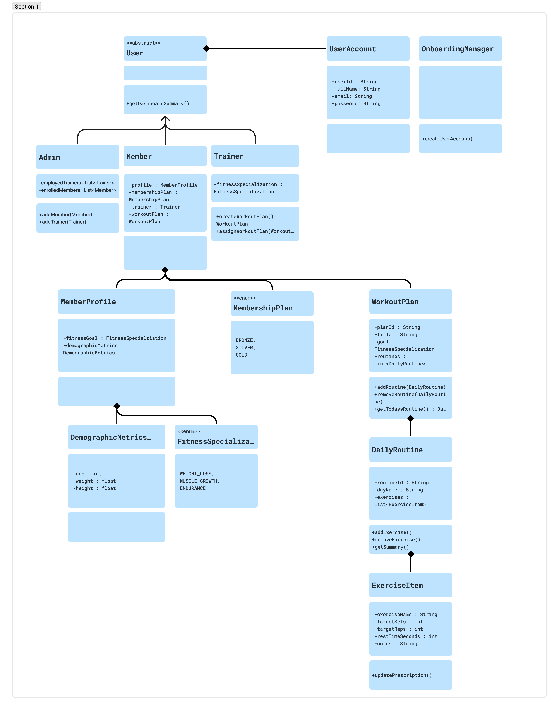

# Gym Membership App
By: Knowell M. Lawas | Nhelmar P. Pahila | Vince Cyrel A. Jurado | Juter R. Blanco | Jeferson Lark L. Manatad  

  
  
  
  

A comprehensive **Gym Membership Management App** designed for Admins, Trainers, and Members unifies facility operations, coaching workflows, and personal fitness tracking into a single system.

Below is the architectural breakdown, feature specifications, and data structure required to build and operate the platform.

## About the Project
### Admin Portal (Operations & Oversight)
The Admin dashboard acts as the command center for facility management, revenue tracking, and resource allocation.

- **User Management (Members & Trainers):** Full CRUD (Create, Read, Update, Delete) capabilities. Admins can onboard new staff, suspend or reactivate member accounts, and manage user profiles.

- **Membership Plan Builder:** Create, edit, and archive subscription tiers (e.g., Basic Monthly, Annual VIP, 10-Session PT Pack). Configurable attributes include pricing, billing cycle, duration, and access privileges.

- **Trainer Assignment Engine:** Assign newly registered members to available trainers based on capacity or specialty, and handle reassignments seamlessly if a trainer goes on leave or a member's goals shift.

- **Gym Analytics & Statistics:** High-level KPI cards and trend charts displaying active vs. expired memberships, monthly recurring revenue (MRR), trainer-to-member ratios, and overall facility check-in or workout completion rates.
### Trainer Portal (Coaching & Programming)
The Trainer interface focuses on client management, program design, and progress monitoring.

- **Client Roster:** A filtered view showing only the members assigned to that specific trainer, highlighting recent activity, membership status, and stated fitness goals.
  
- **Workout Plan Builder:** Create customized routines from scratch or duplicate/modify reusable templates.
  
- **Day & Exercise Structuring:** Organize plans by microcycles or days (e.g., Day 1: Upper Body Push, Day 2: Lower Body). Within each day, trainers define specific exercises along with target sets, reps, weight/intensity, rest intervals, and form notes.

- **Workout Log Review:** Inspect completed workout logs submitted by assigned members. Trainers can compare prescribed targets against actual logged performance, leave feedback, and adjust upcoming plans accordingly.

### Member App (Onboarding & Execution)
The Member experience is streamlined for mobile usability on the gym floor.

- **Onboarding & Goal Setting:** A guided first-login flow capturing baseline metrics (age, weight, height, experience level, injury history) and primary fitness goals (e.g., Hypertrophy, Weight Loss, Endurance).

- **Membership & Trainer Hub:** A clear overview of current plan details, renewal/expiration dates, payment status, and a profile card for their assigned trainer.

- **Interactive Workout Viewer:** Access assigned daily routines with clear instructions, target metrics, and built-in rest timers.

- **Workout Logger:** Frictionless input during workouts to record actual sets, reps, and weights lifted, plus an option to add session notes or rate perceived exertion (RPE).

- **Workout History & Progress:** A chronological log and visual progression tracker (e.g., volume lifted over time, personal records, and workout streak consistency).

## Application Design
### System Architecture & Domain Model
The application is built around a strict object-oriented domain model designed for modularity and role-based separation of concerns:

* **Role-Based Inheritance (`User` Hierarchy):** `Admin`, `Member`, and `Trainer` inherit from an abstract `User` base class, keeping shared attributes unified while isolating role-specific operations (such as trainer assignment vs. workout creation).
* **Account & Onboarding Decoupling:** Authentication credentials (`UserAccount`) and account provisioning (`OnboardingManager`) are separated from core domain entities to keep business logic decoupled from authentication workflows.
* **Member Profiling & Enums:** Each `Member` is composed with a `MemberProfile` containing `DemographicMetrics` (age, weight, height), alongside standardized `FitnessSpecialization` (`WEIGHT_LOSS`, `MUSCLE_GROWTH`, `ENDURANCE`) and `MembershipPlan` (`BRONZE`, `SILVER`, `GOLD`) enumerations.
* **Hierarchical Workout Composition:** Programming follows a nested composition chain—`WorkoutPlan` ➜ `DailyRoutine` ➜ `ExerciseItem`—allowing trainers to structure multi-day microcycles down to granular sets, reps, rest intervals, and coaching notes.  

